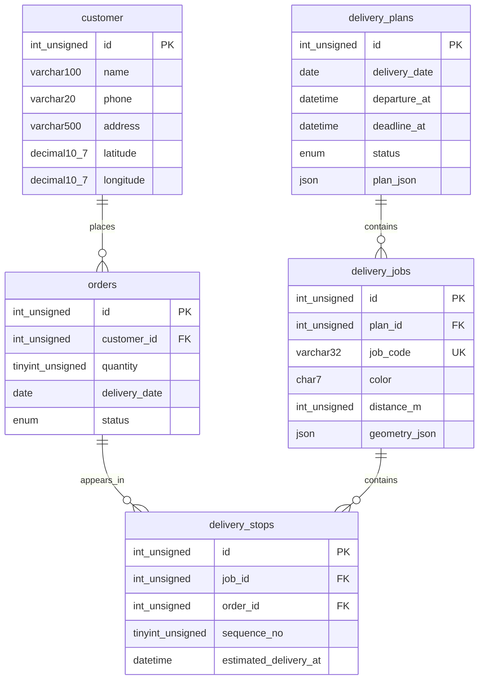

# ER Diagram ของ API ครบระบบ

เพิ่มแถว plan_json ชนิด JSON ใน delivery_plans เท่านั้น ยังใช้ 5 ตารางและเส้นความสัมพันธ์เดิม
บัญชีเจ้าของร้านหนึ่งบัญชีเก็บ username/password hash ใน .env จึงไม่เพิ่มตารางผู้ใช้

plan_json เก็บพิกัดร้าน สมมติฐานเวลา ผลคำนวณ และสำเนาลูกค้า/ออเดอร์พร้อม fingerprint
จึงตรวจแผนล้าสมัยก่อนยืนยันและรักษาข้อมูลเดิมของใบงานได้ โดยไม่เพิ่มฟิลด์ snapshot หลายช่อง

ออเดอร์เดียวอาจอยู่ใน DRAFT หลายแผนเพื่อเปรียบเทียบได้ แต่ backend อนุญาต CONFIRMED เพียงหนึ่งแผนต่อวัน
ใบงานมีจุดส่ง 1–3 จุด โดย sequence_no ไม่ซ้ำภายในใบงาน
